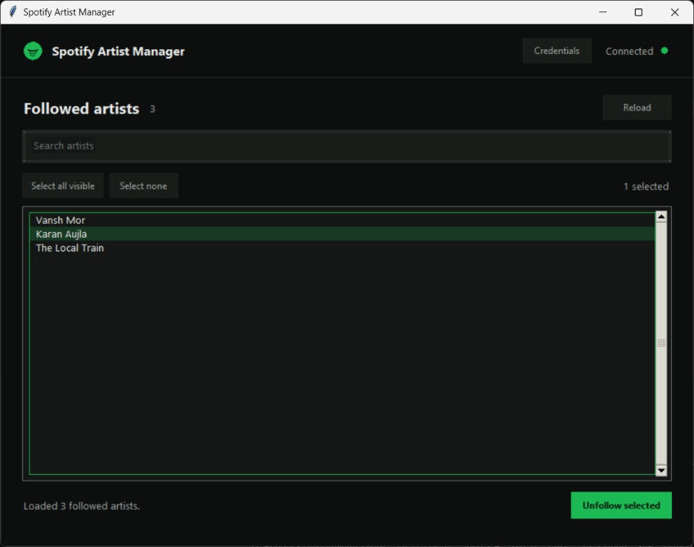

# Spotify Artist Manager

A desktop Tkinter app for viewing and unfollowing Spotify artists.

Connect your Spotify account to browse your followed artists, search the list, and unfollow one or more artists from a simple desktop interface.



## Requirements

- Python 3.10+
- A Spotify Developer application

## Setup

1. Sign in to your Spotify account (or create one) at the [Spotify Developer Dashboard](https://developer.spotify.com/dashboard).
2. Select **Create app** and follow the prompts to register an app.
3. Open the app's settings and copy its **Client ID** and **Client Secret**. These are the credentials this tool needs; keep the Client Secret private.
4. In the app settings, add this exact address under **Redirect URIs** and save the change:

   ```text
   http://127.0.0.1:8888/callback
   ```

5. Install the requirements and start the app:

   ```powershell
   python -m pip install -r requirements.txt
   python spotify_unfollow_gui.py
   ```

6. When the app opens, enter the Client ID and Client Secret when prompted, then connect with your Spotify account to authorize access.

Credentials are stored locally using the Windows Credential Manager when available; they are not included in this repository. Never share or commit your Client Secret.
